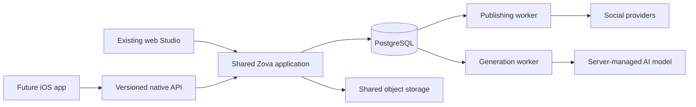

# Shared web and iOS foundations — 12 October 2026

Status: implementation candidate, not deployed. This is not a declaration that all architecture, security or commercial gaps are closed. The 79-item beta register remains open. Existing Render service, database, credentials, subscription enforcement and social grants are unchanged.

## Decision

Keep Render for this phase. Make the application portable before considering a provider move. The reviewed application already uses a Docker image, PostgreSQL and S3-compatible storage. Its immediate constraints were browser-only authentication, an embedded scheduler, import-time schema writes, synchronous generation tied to HTTP, and no versioned native API. AWS does not itself fix those constraints.

Owner preference: keep beta hosting costs minimal. No paid infrastructure, production migration, new bucket, DNS change or deployment has been performed. Separate worker roles are prepared but must not be provisioned merely because the code exists. Exact current invoices, region, traffic, memory, media volume and AI spend have not been retrieved; a savings claim would be unsupported.

## Target and implemented boundaries

One codebase and database; no separate iOS content or publishing engine. A versioned adapter reuses explicitly allowed existing endpoint functions, dependencies and request schemas. API versions protect the client contract; they do not require separate deployments or database copies. Future breaking changes require v2 and a supported overlap period. The existing web API remains unchanged.

### Implemented in this candidate

| Area | Implementation | Limit / rollout condition |
| --- | --- | --- |
| Native identity | Browser account confirmation, exact HTTPS redirect registration, S256 proof, random state, single-use 90-second code | Disabled by default; real iOS universal links/system browser must be validated |
| Device sessions | Opaque 15-minute access token, rotating refresh token, 30-day absolute expiry, hashes at rest, logout/revoke, replay family revocation, password/account revocation | Client must serialize refresh; lost refresh response requires reauthentication |
| Shared content | Workspace ownership enforced for bearer identities using existing scoped database services | Does not complete the separate RLS/grants remediation branch |
| Retry safety | Idempotent draft creation, mandatory revision on native saves, shared reviewed publication ledger | Reusing a key with different job content fails; network failures must not blindly resend generation/publication |
| Pagination | Bounded native draft listing with monotonic ID cursor and search | Stable creation order; not a complete offline change feed |
| Media | Existing validation/upload service; native responses return owned preview paths; local file response checks root; object-store preview uses expiring URL | Existing web raw-media exposure and actual bucket policies remain separate known gaps |
| AI jobs | Durable request/result record, per-owner queue limit, atomic claim, cancellation before start, ownership/auth-version check, stale revision rejection | Disabled until generation worker runs; interrupted jobs require inspection, not automatic replay |
| Shared AI model | Existing central `OPENAI_MODEL` selection reused by both interfaces and background generation | Model changes need capability/quality evaluation; update all worker/web services consistently |
| Process separation | External publishing and generation worker roles with separate PostgreSQL advisory locks and heartbeats; graceful stop between jobs | One active process per role initially; multi-worker job throughput/fencing and load evidence remain follow-ups |
| Database scaling | Bounded PostgreSQL pools; offline preparation command; optional schema verification without runtime DDL | Verification checks tables/columns, not grants, index correctness or RLS |
| Deployment guard | Multi-web configuration rejects SQLite, local-only storage, embedded scheduler and initialization-mode schema writes | Operator must set replica count accurately; cloud configuration is not automatically inspected |
| Operations | Authenticated worker/queue status and API response request identifier | External alert delivery and production monitoring still require setup and evidence |

## Native authentication contract

Use the system browser, not an embedded password form. Generate a cryptographically random verifier and state on-device; retain verifier and state until completion. Launch `/mobile/authorize` with `client_id=zova-ios`, registered `redirect_uri`, `code_challenge_method=S256`, challenge and state. Zova shows the account and requires an explicit Continue action, even with an existing browser session. No social grant is created by mobile sign-in.

After the registered universal-link callback, compare state locally before exchanging the code through `/api/v1/auth/token`. Store tokens in iOS Keychain. Never put tokens, provider credentials or OpenAI keys in URLs, analytics, crash reports or ordinary preferences. Refresh through `/api/v1/auth/refresh`, once at a time; immediately replace both tokens. Replayed refresh tokens invalidate that device session. Absolute session expiry is not extended by refresh. Other devices remain valid unless the account auth version changes.

Existing password login can return to the explicit mobile consent page. New-account onboarding and Sign in with Apple currently land in their existing browser destinations: after completion, restart the app handoff. Smooth native signup/Apple return handling is a pre-iOS-release follow-up, not claimed complete. Social connection changes stay in the existing web account flow; do not launch a connect flow from native without verifying that browser and native accounts/workspaces match. Native social connection return/review still needs device/provider testing.

Based on native-app authorization and refresh-replay principles in [RFC8252](https://www.rfc-editor.org/rfc/rfc8252) and [RFC9700](https://www.rfc-editor.org/rfc/rfc9700). This first-party handoff is not advertised as a general OAuth authorization server.

## Client usage and compatibility

The machine-readable contract is `docs/api/mobile-v1.openapi.json`. `/api/v1/config` announces available capabilities. All private v1 routes require native Bearer authentication; browser cookies cannot silently authorize native API requests. Conversely native tokens do not authorize the existing web routes. `X-Zova-Brand` selects an owned workspace; missing native workspace defaults to zero, ignoring browser cookies.

Create a draft with a stable `Idempotency-Key` per user action. Use the returned revision on subsequent saves; a 409 means reload and reconcile, not overwrite. Deleted draft receipts remain tombstones so a repeated create request cannot resurrect deleted work. When using the AI queue, submit a saved draft ID and revision, then poll the job. Do not re-generate merely because a request timed out. A succeeded job may be read after reconnecting; a failed/interrupted job explains recovery. Normal draft edits still use the same saved records on web and mobile.

Publishing continues through the same review, immutable confirmation and per-platform result handlers. An unknown provider outcome remains unknown until reconciled; a mobile retry does not bypass that rule. No native endpoint grants permission to publish automatically.

## Operating topology and capacity

Initial dedicated topology: one web process, one publishing worker, one generation worker, PostgreSQL and shared object storage. `python -m nova.worker` selects role with `ZOVA_WORKER_ROLE=publishing` or `generation`. Set `ZOVA_SCHEDULER_MODE=external` everywhere only when the publishing worker is deployed. Set `ZOVA_AI_JOBS_ENABLED=true` on the web and generation worker only when that worker is deployed. Existing deployment defaults stay embedded and native/queued AI stay off.

Do not add Redis or Kubernetes just to create the appearance of scale. Current queue admissions, claims, refresh rotation, idempotency and rate buckets are database-backed. Revisit a dedicated broker when measured queue latency or database load warrants it. Keep generation separate from publishing so slow media/model calls do not hold up scheduled posts.

Pool budget: `sum(process_count * (DB_POOL_SIZE + DB_MAX_OVERFLOW))`, plus one advisory-lock connection per worker, migrations and monitoring, must remain below the actual database connection allowance. Start with bounded defaults of 5 + 5 connections per process; tune using measurements. Render's reviewed plan table lists a 100-connection limit for the small database tiers, but verify the actual purchased service. [Render compute plans](https://render.com/docs/compute-plans).

Horizontal web replicas also require completed private shared-media migration, retained encryption/session secrets, explicit schema preparation, compatible release coordination and connection-budget validation. Presence of an S3 environment variable does not prove the bucket is private, reachable or contains all historical assets. These are rollout conditions, not solved by the configuration checker.

## Hosting comparison

| Option | Relevant price evidence | Recommendation |
| --- | --- | --- |
| Render | Published small-service example: $7 web + $7 worker + $6 PostgreSQL; $10 additional Key Value if used | Stay initially; a second small generation worker gives an illustrative $27 compute/database subtotal before storage, transfer, workspace fees, taxes or AI. This is not an invoice or a capacity guarantee. |
| Railway | Pro has a $20 monthly minimum usage commitment; total depends on resource usage | Compare measured usage if Render costs materially increase. Do not equate $20 minimum with a complete stack quote. |
| AWS | Lightsail managed databases start at $15/month; app compute/storage/HA are additional. Fargate resources are metered separately | Consider when region, private networking, enterprise controls or measured scale justify operational complexity. Not demonstrated cheaper here. |
| Cloudflare R2 for media | Standard storage $0.015/GB-month plus operations, with no direct R2 egress fee | Candidate media-store optimisation, independent of app hosting. Validate presigned provider downloads, locality, backups and historical-object migration first. |

Sources checked 12 October 2026: [Render published hosting comparison](https://render.com/articles/production-rails-hosting-guide), [Railway billing](https://docs.railway.com/pricing/understanding-your-bill), [AWS Lightsail billing](https://docs.aws.amazon.com/en_en/lightsail/latest/userguide/amazon-lightsail-frequently-asked-questions-faq-billing-and-account-management.html), [AWS deployment guide](https://docs.aws.amazon.com/pdfs/whitepapers/latest/overview-deployment-options/overview-deployment-options.pdf), [R2 pricing](https://developers.cloudflare.com/r2/pricing/). Prices are USD, not GBP; tax/exchange rates and actual service choices are excluded.

## Rollout, validation and rollback

1. Finish candidate PostgreSQL, concurrent-request, restore and image checks. Obtain independent security review of native authority before enabling it publicly. Retain the full known-gap register.
2. Back up the database and verify a restore alongside media and encryption/session secrets. Prepare schema once through `python -m scripts.prepare_shared_schema`; run using the intended isolated deployment database and appropriate migration credentials. Do not run concurrent preparation.
3. Deploy with mobile and queued AI disabled. Verify the existing web login, drafts, uploads, review and publication-result paths. The new tables are additive. Keep old tables/data and old web contracts.
4. Provision approved workers; use direct/session-pooled PostgreSQL connections for advisory locks, never a transaction-mode pooler. Stop embedded polling before switching the external publishing worker on. Check heartbeat, lag and a mocked scheduled job.
5. Test iOS simulator and real-device callback, cancelled login, wrong account, expired/replayed code, poor network, refresh loss, app reinstall, Keychain clearing and foreground/background transitions. Register exact owned universal link plus Apple association file once team/bundle IDs exist.
6. Enable native access in staging first. Budget queue and AI spend, validate mobile analytics/privacy, subscription/App Store policy, deletion/recovery and provider workflows before public iOS release.

Rollback: disable `ZOVA_MOBILE_ENABLED` and `ZOVA_AI_JOBS_ENABLED`, stop new job intake and let in-flight work finish or mark it interrupted for manual inspection. Stop external publishing before restoring embedded mode; never run duplicate schedulers during rollback. Redeploy previous live `f1c7c12ed3076990b1262e7cefbd614c699f95bd`. Retain additive tables, all customer records, media, secrets and publication ledgers. Never restore an old database over current customer data or replay an unknown publication. Existing browser sessions retain the same format and keys.

## Not yet certified

Actual load capacity, high availability, cloud IAM/private bucket policies, production recovery, distributed worker fencing, staff MFA/audit, final RLS service identity integration and the other beta findings are not closed. Native recurring-series management, native billing, push, complete offline sync, native social-connect/account lifecycle workflows and real-device behavior require further product integration. This candidate supplies tested foundations and a staged path; it does not make the complete app infinitely scalable or commercially ready.

## Validation evidence

Local full application regression:295passed/2skipped. Expanded native/contract/beta tests:26passed/1skipped; the skipped mobile case requires real PostgreSQL advisory locks. Existing Node planning, scheduling, journey and Studio behavior suites passed. Provider requests were mocked and data synthetic. Hosted PostgreSQL/restore/image checks are recorded in the handoff after completion; real iOS/provider/production validation is not claimed.

Hosted validation completed on implementation `0e019e35b71b44da208062dcbf0ca6e12e3c7b65`: PR run [38253467424](https://github.com/davidwilson92-cpu/DataMaxxing/actions/runs/38253467424), push run [38253460927](https://github.com/davidwilson92-cpu/DataMaxxing/actions/runs/38253460927). All required checks passed, including real PostgreSQL concurrency/advisory locking, synthetic backup restoration, hosting-image build/smoke and dependency audit. An initial test assumed SQLite when running against PostgreSQL; the test now explicitly selects its configuration. Draft [PR28](https://github.com/davidwilson92-cpu/DataMaxxing/pull/28) remains unmerged. Production has not changed. These are synthetic/infrastructure checks, not native-device or real-provider validation.
